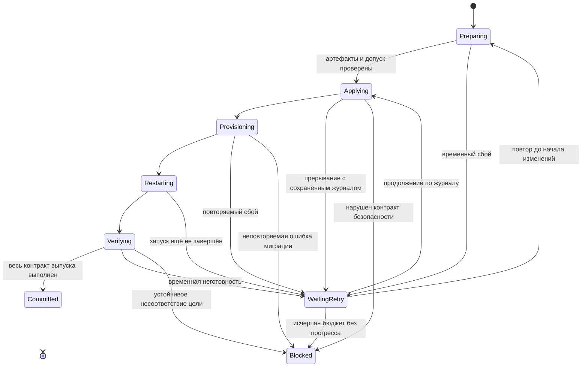

# Автономное обновление до рабочего состояния выпуска

Статус: целевой контракт и границы реализации. Для core реализованы ограниченное
автоматическое восстановление, ранняя доставка retry units, единый managed-план
и общая блокировка updater/standalone loader. Реализован переход с сорванного
provisioning на более новый исправленный core-выпуск с сохранением журналов.
Системное A/B-обновление остаётся отдельной не реализованной частью.
Текущее поведение описано в [архитектуре обновлений](update-architecture.md).

## Контракт для клиента

Клиент выбирает обновление. Устройство самостоятельно доставляет все требования
выпуска, применяет их, выполняет необходимые перезапуски и подтверждает рабочее
состояние. SSH, ручной запуск loader, правка конфигов и включение служебных флагов
не входят в клиентский сценарий. Loader — внутренний исполнитель обновления.

Для важного выпуска действует тот же контракт. Его важность не разрешает обходить
проверку пакета, защиту печати, сохранение настроек или аппаратную готовность.

Успех означает одновременно:

- установлены файлы выбранного выпуска и совместимые зависимости;
- применены обязательные службы, конфиги и миграции этого выпуска;
- Klipper и обязательные MCU готовы, необходимые компоненты Moonraker загружены;
- обязательные службы и выбранный интерфейс прошли устойчивую проверку готовности;
- настройки, калибровки, идентификатор, credentials и пользовательские данные сохранены;
- версия подтверждённого состояния совпадает с версией цели;
- следующее обновление доступно через тот же штатный интерфейс.

Код возврата loader, существование файлов и HTTP 200 по отдельности не доказывают
этот результат. Откат также не считается установкой новой версии.

При исправном оборудовании, доступных проверенных артефактах и корректных миграциях
повторяемая операция должна сходиться к выбранной версии. Нехватка места, отказ
накопителя, аппаратная ошибка или дефект самого выпуска могут остановить переход.
В этом случае устройство сохраняет цель и достоверный результат, автоматически
восстанавливается там, где это возможно, и показывает понятную причину остановки.
Предлагать клиенту команды для исправления продукта недопустимо.

## Состояние реализации

| Участок | Реализовано | Оставшаяся граница |
|---|---|---|
| `treed-core-update.apply/recover` | Неуспешный provisioning сохраняет журнал; root-служба планирует ограниченные повторы той же цели. Временная загрузка и проверка целостности различаются по коду результата. | Бюджет не исправляет дефект самого выпуска; исчерпание попыток остаётся явной ошибкой. |
| `treed-update-service.run_worker/recover/retry_due` | Срок и бюджет сохранены; короткий timer под общим lock возобновляет цель. Подтверждённая печать/пауза откладывает попытку без расхода бюджета. | Реальные systemd и холодная загрузка требуют приёмки на целевой плате. |
| `treed-update-service.submit` и `treed_update._status_payload` | Root проверяет прежний журнал и разрешает новую связанную операцию для строго более нового выпуска. Moonraker предлагает её через обычный apply. Отказ до нового журнала сохраняет прежнюю физическую базу для следующего исправленного выпуска. | Уже созданный forward-only journal на стадии `validated`/`installing` продолжается той же операцией; его произвольная замена не разрешена. |
| `treed-core-update` replacement/replay | Подтверждённый baseline отделён от физической базы установки. Весь подготовленный payload и source проверяются до эффектов; частичная запись продолжается вперёд, актуальный `SAVE_CONFIG` сохраняется. | Нельзя объявлять частично применённую версию рабочей или откатывать только файлы поверх изменённых зависимостей. |
| `loader/loader.sh` | Реестр `managed-runtime.json` определяет managed-шаги и дополнительные source inputs. Новый managed hash охватывает применимый план, старый хеш сохранён для legacy validators. | Требование вне объявленного core-контура нельзя считать применённым только из-за совпадения ревизии. |
| Проверки выпуска | Офлайн-регрессии включают четыре закреплённых старых updater, реальные архивы/проверку source и следующее обновление; системные границы моделируются. | Нужна отдельная аппаратная приёмка обрывов, загрузки, systemd, MCU и сохранения данных. |

Исправления ожидания `startup → ready`, временного HTTP 404 и определения версии
loader в `v0.36.1` закрывают конкретные регрессии, но не заменяют этот контракт.

## Один владелец операции

Сохраняется существующее разделение компонентов:

- Moonraker принимает намерение пользователя и отдаёт состояние. Он не ведёт
  установку и не должен оставаться доступным на протяжении всего перехода.
- `treed-update-service` владеет долговечной целью, блокировкой, запуском и
  восстановлением операции, бюджетом повторов и итоговым результатом.
- `treed-core-update` проверяет артефакты, применяет управляемые файлы и ведёт
  журнал изменений файлов. Loader выполняет необходимые идемпотентные шаги
  подготовки системы под той же операцией.
- systemd запускает обработку сохранённой цели после загрузки и по времени
  следующей попытки. Наличие работающего UI не является условием восстановления.
- UI показывает состояние операции. Закрытие страницы или перезапуск UI не
  изменяет цель и не отменяет восстановление.

Переиспользуются `state.json`, журнал core и общий `flock`. Второй независимый
updater, очередь заданий или база данных для того же состояния не нужны.
Дочерний исполнитель не объявляет всю операцию успешной и не выбирает другой
выпуск. Его результат принимает владелец операции под блокировкой. Поздний ответ
старого процесса должен быть отклонён по идентификатору операции и её поколению.

## Сохранённая цель и подтверждённая версия

Операция хранит отдельно неизменяемую идентичность пакета, желаемое состояние и
последнее подтверждённое рабочее состояние. Минимальный состав записи:

- `operationId`, исходный `requestId`, целевой тег, commit и хеши артефактов;
- последняя подтверждённая версия и ссылка на проверенные данные восстановления;
- стадия, версия схемы журнала, результат последнего шага;
- причина приостановки, время следующей попытки и число последовательных сбоев;
- согласованное сохранение/сброс конфигов и очередь связанного UI-обновления.

Credentials и содержимое пользовательских данных в публичный status не попадают.
Подробные журналы и снимки остаются в защищённом хранилище операции.
Удаление ошибки из UI не удаляет незавершённую цель. `busy=false` само по себе
не означает отсутствие работы для recovery.

## Процесс перехода

Это внутренние состояния проекта, а не уже доступные значения API. Публичное
представление вводится совместимо с установленными версиями UI/Moonraker;
старый клиент не должен принимать ожидание повтора за успешное завершение.

1. **Подготовка.** До остановки рабочей системы проверяются пакет, состав
   перехода, совместимость, место для установки и восстановления. Зависимости
   загружаются заранее там, где их формат допускает локальную установку.
   Недоступная сеть на этой стадии не оставляет принтер с остановленными службами.
2. **Допуск и снимок.** Повторно проверяется отсутствие печати и опасных операций,
   закрываются входы запуска печати, отключается нагрев. После остановки служб
   сохраняются актуальные данные, включая последнее `SAVE_CONFIG`.
3. **Применение.** Выполняется план выбранного выпуска. Каждый шаг допускает
   повтор после обрыва; перед эффектом записывается намерение, после него
   проверяется результат. Незавершённый шаг выполняется повторно, а не считается
   выполненным по наличию записи о начале.
4. **Перезапуск и готовность.** Переходные состояния запуска опрашиваются с
   ограниченным ожиданием. Аппаратные ошибки не скрываются ожиданием. Проверяется
   весь обязательный состав выпуска, а не только доступность HTTP API.
5. **Фиксация.** Подтверждённый manifest и признак завершения записываются с
   синхронизацией на диск. Публичное `applied` появляется после фиксации.
   После обрыва между этими записями recovery повторно проверяет точный manifest
   и готовность, затем завершает ту же операцию.

Повторы используют нарастающую задержку и сохранённое время следующего запуска.
Изменение status-файла не должно создавать немедленный бесконечный цикл
`PathChanged → worker → запись ошибки → PathChanged`. Бюджет ограничивает
последовательные попытки без прогресса; его исчерпание сохраняет цель и переводит
операцию в диагностируемое состояние. Перезагрузка не обнуляет этот бюджет.

## Полный состав выпуска

Manifest должен описывать обязательные runtime-компоненты, закреплённые
зависимости, службы, конфиги, версии миграций и проверки результата. План строится
из установленного состояния и требований выбранного выпуска. Он не зависит от
догадки пользователя, является ли обновление «критичным».

Managed и standalone loader используют один реестр шагов и общие исполнители.
У каждого шага определены владелец данных, условие применения, признак завершения,
условие безопасного повтора и проверка результата. Режим запуска меняет владельца
операции, но не разрешает молча пропускать обязательное требование выпуска.
Опциональный компонент может быть пропущен только если manifest не требует его
для работоспособности выбранного профиля.

ОС, bootloader и прошивки MCU не становятся безопасно обновляемыми от запуска
всех shell-шагов подряд. Выпуск, которому нужен такой переход, должен включать
его поддерживаемый механизм, артефакты и аппаратную приёмку. До их реализации
такой выпуск нельзя выдавать клиентам как применимый обычным core updater.
Будущий A/B-контур остаётся отдельной задачей, описанной в
[существующей архитектуре](update-architecture.md#системное-ab-обновление-пока-недоступно).

## Восстановление и данные

Для локальных настроек действует [модель владения](config-ownership.md).
Запись новой версии в manifest не заменяет проверку сохранности credentials,
UUID, калибровок и пользовательских данных. Миграции данных имеют собственную
версию, контроль до/после и проверенный снимок до первого изменения.

До необратимой миграции допустим откат к согласованному прежнему состоянию.
После изменения зависимостей нельзя откатить только Python-файлы и объявить
систему восстановленной. Требуется либо полный проверенный откат всех затронутых
слоёв, либо продолжение вперёд по журналу. Отдельный `rollback_succeeded` не
снимает незавершённую цель новой версии.

При аппаратной ошибке recovery не начинает движение, нагрев или печать.
Остановка для физического ремонта отличается от программной ошибки обновления;
для неё нужен понятный статус, а не инструкция клиенту редактировать файлы.

Если сам опубликованный пакет содержит дефект, бесконечный повтор не исправляет
его. Через обычную команду обновления можно выбрать доступный более новый выпуск.
Root связывает новую операцию с проверенным прежним журналом; клиент не передаёт
ссылку на произвольную базу. Старая операция остаётся в истории, старый ZIP не
меняется. Автоматические повторы сохраняют выбранную цель и сами не выбирают
`latest` посреди незавершённой миграции.

Переход на исправленный выпуск использует новую операцию, связанную с
прежним журналом. Перед изменениями updater подтверждает допустимую стадию,
идентичность и структуру прежнего target manifest, известное владение файлами и
строго более новую версию. Физическая installation base хранится отдельно от
подтверждённого baseline: частично установленная версия не объявляется рабочей.
До первой записи проверяется весь новый набор подготовленных файлов и source.
После обрыва записи recovery дописывает проверенную цель; откат отдельных файлов
к уже несовместимым зависимостям запрещён. Новые локальные изменения требуют
проверки и явного согласия на сброс, а актуальный `SAVE_CONFIG` сохраняется.
Старые архивы, согласия и before-images остаются для диагностики. Прежнее согласие
на сброс хранится как аудит; новый сброс требует нового согласия на актуальный hash.

Если новый пакет не загрузился, не прошёл проверку либо не запустилась служба
до начала установки, следующая команда обновления может выбрать ещё более новый
выпуск. Ссылка на прежнюю физическую базу сохраняется. Для ошибки проверки пакета
недостаточно одного result code: root требует сохранённую фазу
`queued`/`validating`/`downloading` и отсутствие нового журнала, включая symlink.
Новый тег должен быть новее и последней выбранной цели, и физической базы.
Если forward-only journal уже создан на стадии `validated` или `installing`,
recovery продолжает ту же операцию. После начала provisioning допускается новая
проверенная замена. Неизвестная стадия не разрешает запись или обход admission.

## Переход с уже установленного updater

Новый пакет не меняет код уже работающего старого процесса. Поэтому совместимость
проверяется начиная со старого `submit/apply`, а не с прямого вызова нового worker.

Для работающих старых установок сохраняется принимаемый ими формат пакета,
разрешённые назначения файлов и CLI-контракты. Существующий managed-loader
entrypoint доставляет новую логику восстановления и её systemd-запуск. До
критичных миграций должна быть сохранена цель в формате, который новый recovery
сможет прочитать. Пока старый worker удерживает lock, он остаётся единственным
владельцем; новая служба подхватывает цель только после его завершения.
Переход обязан работать и при пропуске промежуточных релизов.

Если нужна промежуточная версия updater, устройство само устанавливает её и
продолжает исходную цель. Нельзя просто добавить `minUpdaterVersion` и потребовать
от клиента предварительно выполнить loader. Для каждого старого протокола нужно
доказать, каким уже доступным ему путём загружается промежуточный исполнитель.
Если этот путь не установлен, автоматическая миграция пока не реализована.

Отдельный блокер — уже застрявшая операция старого updater, который допускает
только повтор прежнего ZIP. Так ведёт себя текущий recovery для сорванного
`v0.34.1`. Публикация новой версии сама по себе этот код не заменяет. Автоматический
переход для таких установок нельзя считать закрытым, пока не доказан доступный
старому устройству канал доставки исправления. Нельзя подменять неизменяемый
архив, тайно править `state.json` или объявлять устройство неподдерживаемым ради
обхода проблемы. Согласованный ручной loader на разработческом принтере не
подтверждает готовность клиентской миграции.

## Приёмка перед выпуском клиентам

| Сценарий | Обязательный результат |
|---|---|
| Здоровая поддерживаемая старая версия → новый пакет | Полное целевое состояние без ручной подготовки. |
| Пропуск промежуточных версий | Автоматический переход через необходимые миграции или внутренний bridge. |
| `startup → ready`, временный HTTP 404, медленный старт | Автоматическое ожидание и продолжение той же операции. |
| Обрыв загрузки или недоступная сеть до установки | Старая система остаётся рабочей, загрузка возобновляется автоматически. |
| SIGKILL/отключение питания на каждой изменяющей стадии | После загрузки остаётся один владелец; операция продолжается либо выполняется допустимое восстановление. |
| Ошибка шага loader, затем устранение временной причины | Продолжение по сохранённой цели без повторного действия клиента. |
| Повторяемая постоянная ошибка | Нет бесконечного цикла и ложного `applied`; сохранены цель, данные и диагностика. |
| Повреждённый пакет, конфликт чужих файлов, печать/пауза | Защита не обходится повтором или признаком важности выпуска. |
| Дефектный сохранённый выпуск → исправленный | Проверенный переход без изменения старого ZIP и без смешения несовместимых версий. |
| Два запроса, reboot во время фиксации, core + UI | Нет конкурирующих изменений, потери цели или второго шага UI. |
| Обновление → следующее обновление | Новый updater обслуживает следующий переход тем же клиентским путём. |

Исторические проверки используют закреплённые исходники настоящего старого
updater и конфигурации. Нельзя заменить проверяемую установку или миграцию моками.
На Linux допускаются модели сети, systemd и оборудования с явным указанием границ.
Отдельная аппаратная приёмка проверяет systemd, холодную загрузку, MCU и сохранение
настроек на целевой плате. Сборка нового состояния сама по себе не закрывает переход.

## Граница приёмки

Долговечная цель, ограниченные повторы, единый managed-план и связанный переход
на исправленный выпуск реализованы в существующих updater и loader. Офлайн-тесты
проверяют реальные архивы, изменения файлов и сохранность данных; сеть,
systemd и аппаратная готовность в этих тестах моделируются.

Перед допуском изменения системного или аппаратного контура нужна приёмка на
целевой плате по матрице выше. Отдельно остаётся доставка исправления на уже
застрявший старый updater, который не умеет выбирать другую цель. Локальные
проверки нового кода и ручной loader на разработческом принтере не закрывают
эту границу совместимости.
